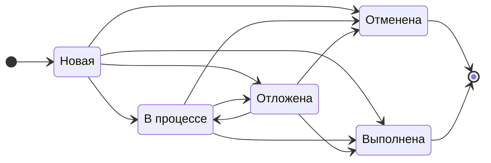

# Функциональные требования

| ID | Функциональное требование | Критерии приемки | Приоритет |
|----|---------------------------|------------------|-----------|
| FR-001 | Создание задачи | Для создания задачи необходимо заполнить обязательные поля: название, категория, дата и время выполнения. После сохранения задача отображается в календаре/списке задач. | Must |
| FR-002 | Указание срока выполнения задачи | В задаче доступны поля для указания даты и времени выполнения. | Must |
| FR-003 | Выбор категории задачи | Категория выбирается из доступного списка: «Дом и уборка», «Ремонт и обслуживание», «Покупка для дома», «Семья и дети», «Путешествия», «Праздники», «Личные задачи». | Must |
| FR-004 | Настройка регулярности выполнения задачи | Поле «Регулярность задачи» по умолчанию имеет значение «Никогда». Доступные варианты: «Каждый день», «Каждую неделю», «Каждый месяц», «Каждый год». | Should |
| FR-005 | Настройка напоминания о задаче | При включенном напоминании система отправляет уведомление в заданное время. | Should |
| FR-006 | Просмотр списка задач | Задачи отображаются в календарном формате с возможностью просмотра по дням, неделям и месяцам. | Must |
| FR-007 | Изменение статуса задачи | Доступны статусы: «Новая», «В процессе», «Отложена», «Выполнена», «Отменена». Переходы между статусами выполняются в соответствии со схемой переходов (см. ниже). | Must |
| FR-008 | Возможность определить приоритет | Доступны уровни приоритета: «Высокий», «Средний», «Низкий». | Could |
| FR-009 | Редактирование задачи | Пользователь может редактировать параметры задачи. После сохранения изменений система отображает обновленную версию задачи. | Must |
| FR-010 | Удаление задачи | Пользователь может удалить созданную задачу. Перед удалением система отображает подтверждение действия. | Must |
| FR-011 | Формирование рекомендаций на основе категории задачи | Система должна формировать рекомендации товаров и услуг партнеров платформы после создания пользователем задачи на основе ее параметров. | Must |
| FR-012 | Отображение рекомендаций | Блок рекомендаций содержит список предложений партнеров с информацией: название товара или услуги, краткое описание, стоимость. | Must |
| FR-013 | Переход к предложению партнера | При выборе рекомендации открывается страница товара или услуги партнера. | Must |

## FR-007. Схема переходов между статусами задачи

Схема:

